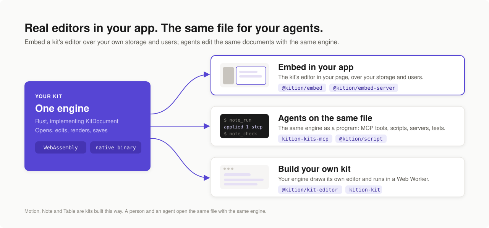
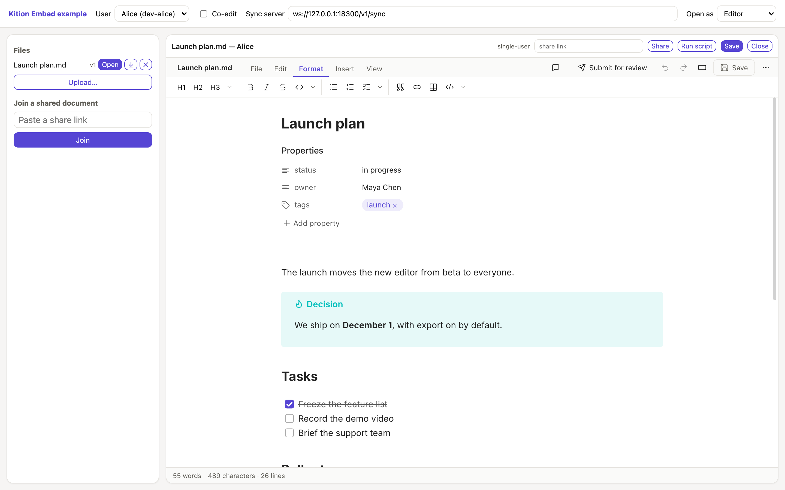
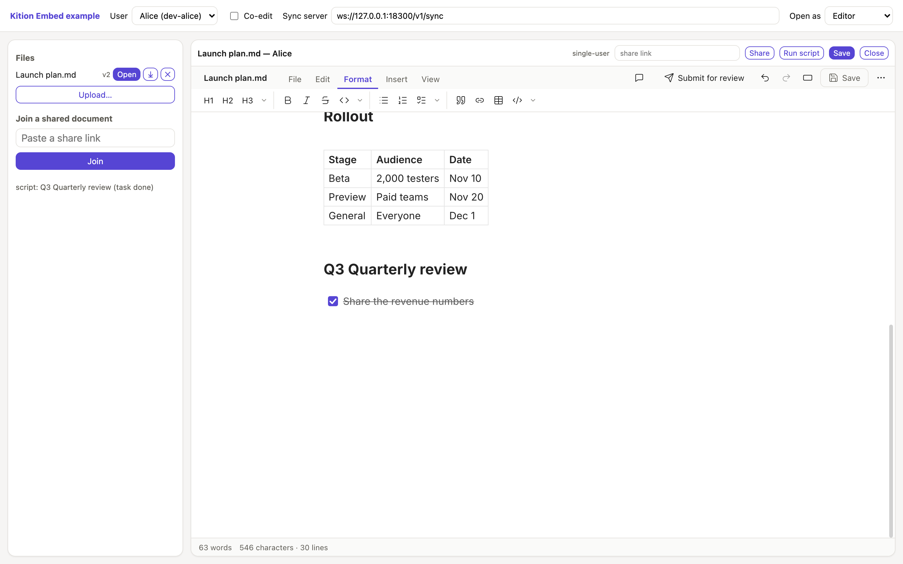
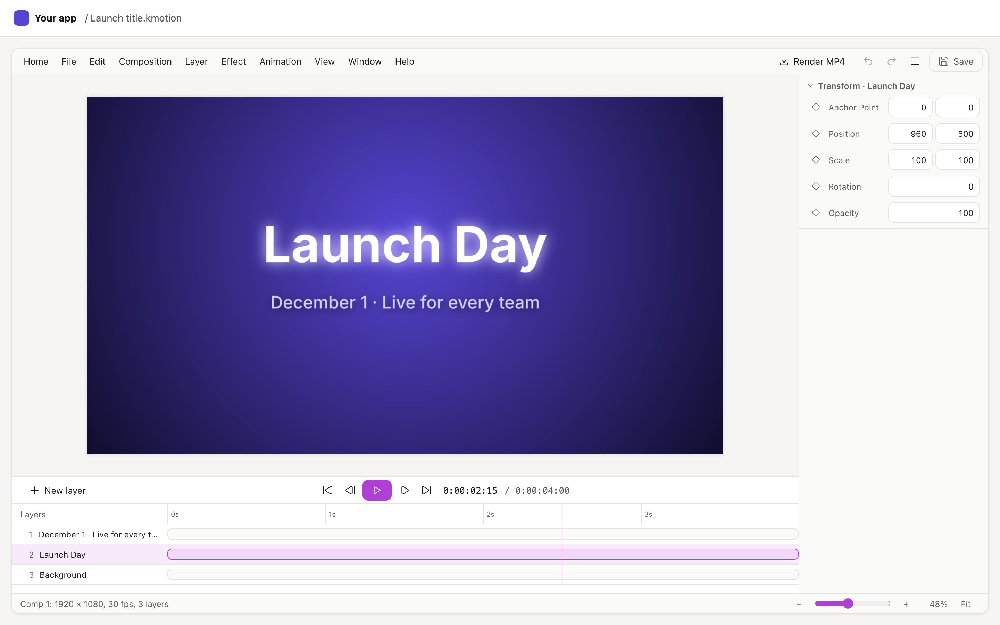
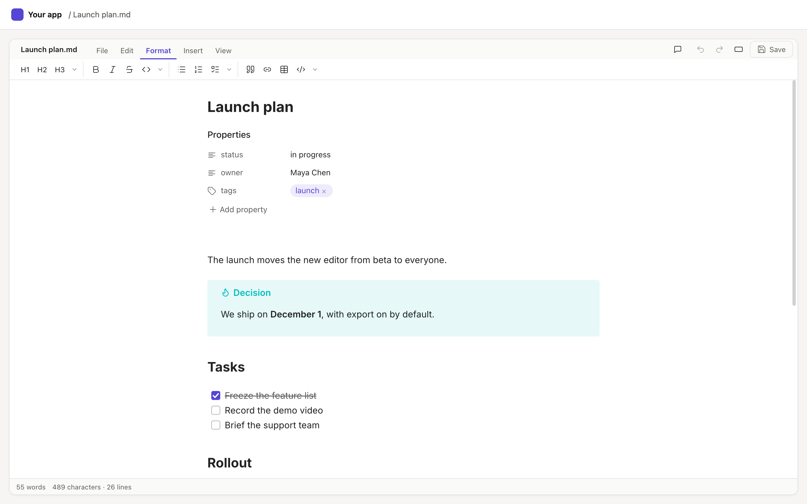
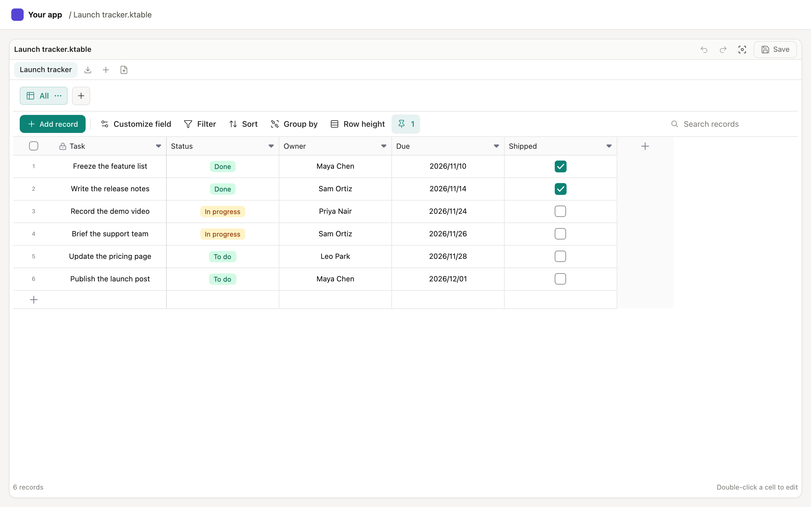
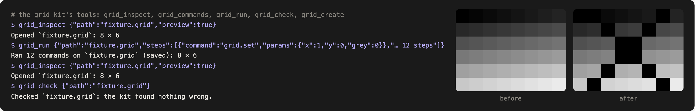
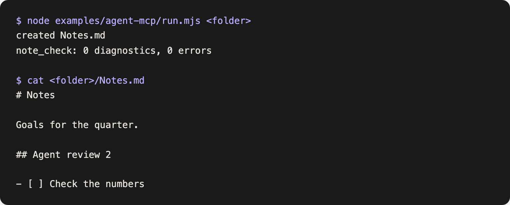
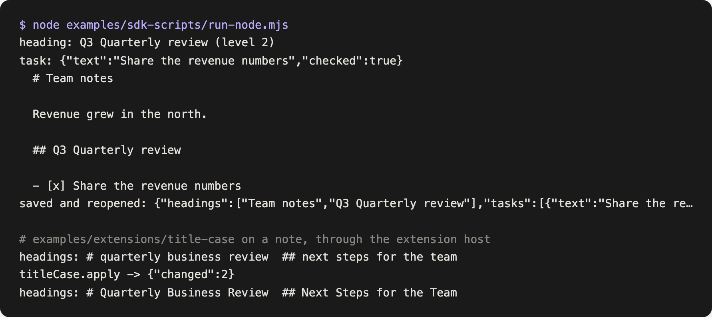
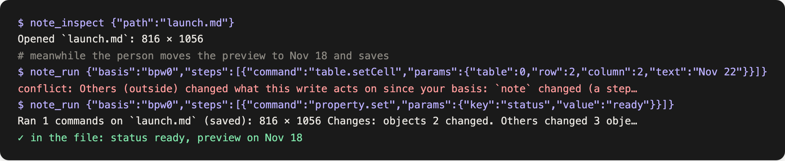

<div align="center">



# Kition SDK

**Real document editors in your app, and the same documents for your AI agents.**

Embed a kit's editor in your page with `@kition/embed`, or by signed iframe URL with `@kition/embed-server`.<br />
Your storage, your users; agents edit the same files with the same engine.

[Kition](https://kition.ai) · [Developer docs](https://developer.kition.ai) · [Embed guide](docs/sdk/embed.md) · [SDK guide](docs/sdk/README.md) · [Platform contracts](docs/platform/index.md) · [Kition Note](https://github.com/KitionAI/kition-note) · [Kition Tessera](https://github.com/KitionAI/kition-tessera) · [KHP](https://github.com/kitharness/kitharness)

[](LICENSE)
[](https://www.npmjs.com/package/@kition/embed)
[](https://www.npmjs.com/package/@kition/embed-server)
[](https://github.com/kitharness/kitharness)

</div>

Kition is 16 professional editors, called kits. The same kit and the same engine serve a person
(the editor), an AI agent (commands) and a program (code). A **kit** is everything one kind of
document needs: an engine that opens, edits, renders and saves it, the editor people work in, and
the commands agents and programs call. The Kition SDK puts kits in your product: embed a kit's
editor in your app, let your agents work on the same files, run kits on your servers, or build a
kit of your own. The [SDK guide](docs/sdk/README.md) lays out the ways in. [Kition](https://kition.ai) is built on it. Kits follow the
[Kit Harness Protocol (KHP)](https://github.com/kitharness/kitharness), so any host that speaks it can run
them.

## Embed a kit's editor in your app

<table>
<tr>
<td width="50%"></td>
<td width="50%"></td>
</tr>
</table>

Two ways in, both free and with no license key:

- **In your page: `@kition/embed`.** Mount a kit's editor in an element of your page. It runs
  from its own origin in a sandboxed frame; files stay in your storage, people come from your
  identity system, and you decide who may edit, comment or view. A write carries the version it
  read, so an edit made elsewhere is never written over.
- **By URL: `@kition/embed-server`.** For pages that cannot run a module: your server signs a
  URL for one person and one file, your page frames it, and the embed server shows the editor and
  reads and writes the file through HTTP callbacks to your server
  ([guide](docs/sdk/url.md), [`examples/url-embed`](examples/url-embed)).

```ts
import { KitionEmbed } from '@kition/embed'

const editor = await KitionEmbed.mount(element, {
  kit: { id: 'kit.note', url: 'https://kits.example.com/note-ui/' }, // the kit package you host
  file: { id: 'plan-2026', name: 'Plan.md' },
  storage,  // yours: read, stamp, write (versioned), create
  identity, // yours: user, users, permissions
})
```

[`examples/embed-app`](examples/embed-app) is a page with its own file list that embeds the Note
editor (above); its **Run script** button edits the open note through the object model (right).
Co-editing goes through a `kition-sync/1` server. The full guide is
[docs/sdk/embed.md](docs/sdk/embed.md).

## Kits

Every kit embeds the same way. Each picture below is the kit's editor running embedded, with
`@kition/embed`, in a plain page of "your app".

### Motion: available now



Motion graphics and video: compositions, layers, keyframes, effects, text animation presets and
MP4 rendering, with checks that point out what makes a frame look flat. Kition's most used kit.
Published: [Kition Motion](https://github.com/KitionAI/kition-motion); its self-contained editor
package is `@kition/kit-motion-ui` on npm (the folder `motion-ui/`).

### Note: available now



Markdown notes, Obsidian-flavoured, that keep the file byte for byte. Published:
[Kition Note](https://github.com/KitionAI/kition-note); its self-contained editor package is
`@kition/kit-note-ui` on npm (the folder `note-ui/`).

Each kit's headless engine is on npm too, for macOS, Linux and Windows
(`@kition/kit-<kit>-<platform>`); `kition kit install <kit>` installs it, checked against the size
and integrity the kit index gives ([cli](docs/sdk/cli.md), [distribution](docs/sdk/distribution.md)).

### Table: available now



Tables with typed fields, views (grid, kanban, gallery, calendar), filters, sorts, groups and
dashboards. Published: [Kition Table](https://github.com/KitionAI/kition-table); its
self-contained editor package is `@kition/kit-table-ui` on npm (the folder `table-ui/`).

### HTML: available now

HTML pages (`.html`, `.htm`) with their CSS rendered and bounded JavaScript run, edited as source
with undo and redo. Published: [Kition HTML](https://github.com/KitionAI/kition-html); its
self-contained editor package is `@kition/kit-html-ui` on npm (the folder `html-ui/`).

### Every other kit: available now

All 16 Kition kits are published, each from its own repository, which publishes its
self-contained editor package on npm as `@kition/kit-<kit>-ui` (the folder `<kit>-ui/`) and its
headless engine as `@kition/kit-<kit>-<platform>`:
[Board](https://github.com/KitionAI/kition-board) (whiteboards),
[Doc](https://github.com/KitionAI/kition-doc) (word-processing documents, `.docx`),
[Sheet](https://github.com/KitionAI/kition-sheet) (spreadsheets),
[Slide](https://github.com/KitionAI/kition-slide) (presentations),
[PDF](https://github.com/KitionAI/kition-pdf),
[Photo](https://github.com/KitionAI/kition-photo) (layered images),
[Vector](https://github.com/KitionAI/kition-vector) (vector drawings),
[Layout](https://github.com/KitionAI/kition-layout) (page layouts),
[Design](https://github.com/KitionAI/kition-design) (interface designs),
[Film](https://github.com/KitionAI/kition-film) (video projects),
[CAD](https://github.com/KitionAI/kition-cad) (`.dxf` drawings) and
[Scene](https://github.com/KitionAI/kition-scene) (3D scenes).

## Build your own kit



Implement `KitDocument` for your engine and export it with `kition_kit::export_kit_document!`. The
SDK gives the rest: the WebAssembly exports for the page, the headless executable, the agent
tools, and a contract check your tests run. [`examples/grid-kit`](examples/grid-kit) is the
smallest complete kit, a few hundred lines: above, an agent draws a cross on its 8 × 6 grid
through the MCP tools the SDK made from its `kit.json`, and the previews are the kit's own
rendering.

## Agents over MCP



`kition mcp` serves every kit in a folder as MCP tools (`note_inspect`, `note_run`,
`note_check`, ...) for any MCP client. Agents edit the same files people do, with the same engine,
and can ask the kit to check their own work. Edits can go to a draft that the person reviews and
merges. [`examples/agent-mcp`](examples/agent-mcp) is the agent's side, in a few dozen lines.
Connecting Claude Code, Claude Desktop, Cursor or Codex: [docs/sdk/agent.md](docs/sdk/agent.md#connect-your-agent).

`kition mcp` is a command of `kition`, the command line, which comes without the kits and downloads
each kit the first time an agent opens a file of it. It works like a container tool: a kit is an
image, `kition kit install` is `docker pull`, and `kition mcp`, `kition serve` and
`kition gateway` run the kits on a workspace folder. With Node.js 20 or later, from npm:

```sh
npm install -g @kition/cli
kition agent add claude          # in your project folder; or codex, cursor
# or, without installing: claude mcp add kition -- npx -y @kition/cli mcp --workspace "$PWD"
```

Without Node.js, the same `kition` from npm (registry.npmjs.org, else its mirror registry.npmmirror.com):

```sh
curl -fsSL https://unpkg.com/@kition/cli/dist/install.sh | sh
~/.kition/bin/kition agent add claude
```

On Windows, `irm https://unpkg.com/@kition/cli/dist/install.ps1 | iex`.
See [docs/sdk/cli.md](docs/sdk/cli.md).

## Scripts and extensions



`@kition/script` reads and edits documents through a typed object model, in a page or in Node,
on the engine in the page, in a kit package, or on a headless kit. One script runs unchanged in
all three: [`examples/sdk-scripts`](examples/sdk-scripts). Extensions (`@kition/extensions`) add
commands and panels to a kit, each in a sandbox with only the permissions it declares;
[`examples/extensions/title-case`](examples/extensions/title-case) title-cases a note's headings.

## Safe concurrent edits



People and agents edit the same file at the same time. Every write says which version it read.
When someone else has since changed the thing a write is about, the write is refused, nothing is
lost, and the writer is told what changed so it can decide again. A write about something else
goes through. Above: the person moves a date while an agent is working; the agent's edit to that
date is refused, and its edit to the note's status is applied.

## Packages

The packages share one version, the SDK's (`sdk.json`), and are published under the [`@kition` scope on npm](https://www.npmjs.com/org/kition), and the command line as [`@kition/cli`](https://www.npmjs.com/package/@kition/cli).

| Package | What |
| --- | --- |
| [`@kition/embed`](packages/embed) | Embed kit editors in any web page, over your storage and identity |
| [`@kition/embed-server`](packages/embed-server) | Serve single-user kit editor pages for embedding by URL |
| [`@kition/cli`](packages/kition) | The `kition` command line from npm: `npm install -g @kition/cli`, or `npx -y @kition/cli mcp --workspace <folder>` for agents; it installs each kit on first use |
| [`@kition/script`](packages/script) | The object model for scripts and extensions, in browsers and Node |
| [`@kition/extensions`](packages/extensions) | The extension host: manifests, sandboxed workers, declared permissions |
| [`@kition/sync`](packages/sync) | Client for the open sync protocol `kition-sync/1` |
| [`@kition/kdm`](packages/kdm) | The Kit Data Model, the replicated document model kits declare their documents in |
| [`@kition/kit-editor`](packages/kit-editor) | Build a kit's own editor: host connection, session, engine canvas, shared components |
| [`@kition/kit-engine`](packages/kit-engine) | The engine contract in TypeScript, for a kit's engine worker |
| [`@kition/kit-host`](packages/kit-host) | The host's side of the Kit UI protocol |
| [`@kition/kit-ui-protocol`](packages/kit-ui-protocol) | Kit UI protocol message types |
| [`@kition/kit-dev-host`](packages/kit-dev-host) | A development host to run a kit's editor without Kition |
| [`@kition/convergence`](packages/convergence) | Multi-replica convergence scenarios for TypeScript engines |

The Rust crates are used as git dependencies of this repository, pinned by commit
(`kition-kit = { git = "https://github.com/KitionAI/kition-sdk", rev = "<commit>" }`):

| Crate | What |
| --- | --- |
| [`kition-kit`](crates/kition-kit) | The `KitDocument` contract, WebAssembly exports, and contract checks |
| [`kition-kdm`](crates/kition-kdm) | The Kit Data Model |
| [`kition-headless`](crates/kition-headless), [`kition-kit-server`](crates/kition-kit-server) | Serve a `KitDocument` headless over the Kit Process Protocol |
| [`kition-kits`](crates/kition-kits) | The servers behind `kition mcp` and `kition serve`: kits as agent tools, drafts, guarded writes |
| [`kition-kit-host`](crates/kition-kit-host), [`kition-kit-process-protocol`](crates/kition-kit-process-protocol) | Launch kit processes and speak their protocol |
| [`kition-convergence`](crates/kition-convergence), [`kition-env`](crates/kition-env) | Convergence suite; kits as training and evaluation environments |

## Quick start

Embed a kit in your app, from npm:

```sh
npm install @kition/embed           # the editor in your page
npm install @kition/embed-server    # or: the editor by signed iframe URL, served by your server
npm install @kition/script          # read and edit documents from code
```

The Note kit's editor package (editor, engine and fonts, self-contained) is `@kition/kit-note-ui`
on npm. Put its `note-ui/` folder where your kit origin serves it:

```sh
npm pack @kition/kit-note-ui                     # kition-kit-note-ui-<version>.tgz
tar -xzf kition-kit-note-ui-<version>.tgz        # package/note-ui/
mv package/note-ui <kits>/                       # <kits>/note-ui/
```

Run kits on a server, from any language (JSON lines on stdin and stdout,
[hosts](docs/sdk/hosts.md)):

```sh
npm install -g @kition/cli
kition kit install note
kition serve --workspace <folder>
```

Run the examples from a clone. The workspace links Kition Tessera, so clone it beside this
repository:

```sh
git clone https://github.com/KitionAI/kition-tessera
git clone https://github.com/KitionAI/kition-sdk && cd kition-sdk
pnpm install

# A kit of your own: the grid example's contract tests, and its headless executable
cargo test -p grid-kit --test contract
cargo build -p grid-kit-headless

# The embed example, with the Note kit package unpacked into <kits>/note-ui/
KITION_KITS_DIR=<kits> pnpm example:embed              # http://127.0.0.1:5310

# Scripts on the Note kit package, in Node
KITION_KITS_DIR=<kits> pnpm test:sdk:example

# The agent example: kition-kits-mcp here, kition-note from a kition-note checkout
cargo build -p kition-kits --bin kition-kits-mcp
KITION_KIT_NOTE_BINARY=<kition-note>/target/debug/kition-note node examples/agent-mcp/run.mjs
```

The pictures in this README are made by [`tools/readme-shots.mjs`](tools/readme-shots.mjs) from
these examples, running; it is a tool, not a test.

## Documentation

- **[SDK guide](docs/sdk/README.md)**: the Command API and the Script API; the ways in (embed,
  URL, server, the `kition` command line, collaboration); agents beside people; environments and
  distribution.
- **[Platform contracts](docs/platform/index.md)**: the engine contract, the Kit UI and Kit
  Process protocols, the Kit Data Model, capability sets, and conformance levels. Start with the
  [engine contract](docs/platform/kits/engine.md) to write a kit.
- **[Call context](docs/platform/kits/call-context.md)**: how writes name what they rest on, and
  the refusals when it has changed.

## Build and test

The workspace links Kition Tessera, so clone
[kition-tessera](https://github.com/KitionAI/kition-tessera) beside this repository first.

```sh
pnpm install --frozen-lockfile
cargo build -p kition-kit-mock   # host tests launch the mock kit's executable
cargo test
pnpm typecheck
pnpm test
```

[CONTRIBUTING.md](.github/CONTRIBUTING.md) names the toolchain and the check every change passes;
[docs/development.md](docs/development.md) covers the npm packages, and
[docs/quality.md](docs/quality.md) and [features.yaml](features.yaml) the tests. Changes are in [CHANGELOG.md](CHANGELOG.md).

## License

Apache-2.0; see [LICENSE](LICENSE). Every part of the SDK is free to use, in development and in
production, with no license key.
