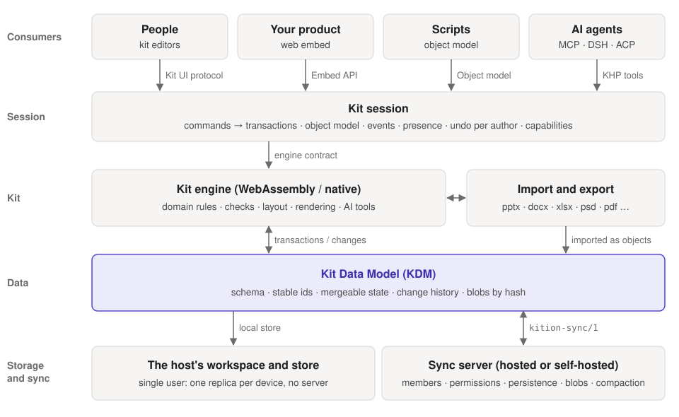

# The Kit Data Model: an introduction

Tree structural changes are told by the affected items'
`created`, `moved`, `deleted` entries, without an empty-edits holder entry.
Batch deletion walks `owns` refs/maps and owning lists/trees, children before
holders, atomically; a non-owning ref is left alone. The shared
`delete-owned.json` fixture holds the cases.
Tool-id-less parts retain normal holder attribution. Command name resolution
honors parameter type declarations and additional `name_params`; deleted
objects' names are retained in journal values for the guard. Carried effects
are computed from each changed/moved entry, including fields and edits, so
content changes such as renames do not imply spatial movement.

Environment metadata: a field's optional `label` is its
human wording, used as the positive state of a boolean. Model describe
keeps it. Reversed ordinal words come from command index
declarations and do not reverse canonical lists, trees or batch indexes.
Unreadable environment input files are reported and skipped individually.

## Positional Batches And Replay

The SDK automatically derives gap/window premises for model creation at an
index, list insert/move and tree insert/move. Destination gaps hold their
neighbours and boundaries, and moves hold their source. Nested container paths
resolve through lists and owned refs at supported path depths. Move indexes use
pre-removal coordinates. Kits update the SDK without a new schema property or
hook; use either `target:"comp:1", field:"layers"` or the actual nested holder
path. A raw operation on a nested holder path (`target: 1, field: "comp.layers"`,
the place a receipt's move names) is checked with the `batchOps` contract of the
object holding its last field (the comp's `list.move.layers`), on that object; an
operation that object declares no contract for still refuses. A receipt's parent
is a `target` as given, the number `1` or the string `"1"`. Strictly unrelated
later list edits remain independent.

Environment creation replay reconstructs the owning graph: create referenced
objects first, bind their refs, restore their containers and then create the
owner. Kits keep `owns: true` and expose complete values/loads. Consumers of
task solutions accept multiple operations for one conceptual creation. The
saved-state replay checks preserve object/reference identity under consistent
renaming of fresh ids. No KDM storage-format change is needed. See the
[batch validation and replay contract](kits/call-context.md#batch-validation-and-replay)
for the required declarations and retention limits.

## Historical Blob Bytes

Rust `blob_source` and batch settling/conditional-limit hooks belong to the SDK's
`session` feature. Core kit contracts build without KDM or that feature.

List windows hold membership even when a command addresses the holder
by id. Ordinal windows use `[from,to)`; time/space windows use `time.start` and
optionally `end` or `duration`. With neither, `start` is a point ordering field
(for example a key's time). Entries inserted, removed or moved into/out of the
window refuse, including changes later reversed in the journal. Changes outside
the window and member content not otherwise held remain independent.

An ordinal window holds which objects are at its positions `[from,to)`, the
indexes the kit answers for the list as it is now, which name the same positions
in every version of the list. Each change by another writer is read in the list
just before and just after it: it refuses when it creates or deletes an object
inside the window, moves one across an end of it (in or out, to another list
too), shifts one across an end by inserting or removing items before the window
(the window counts positions, so an insertion or removal before `from` changes
which objects are in it), or changes a member's `position` field. A reorder among
the members (every object stays inside) applies, as do edits after `to` and
member content not otherwise held; hold an exact order with an id's position
premise (`positions: [<list field>]`) or `orders`. A window over a whole list
starts at 0 and ends past the last item, `[0, n+1)` for the `n` members there
are now: the kit answers it after others' changes, so a window ending at `n`
would leave a removed last member (at index `n` before its removal) outside it.
`[i,i)` is an insertion gap, which holds its two neighbours.

The SDK retains historical bytes across headless file reloads. Complete blob
references remain in journal `before` values; public `after` values remain size
summaries. A kit opts in with `KitDocument::blob_source()`, returning its open
session's `BlobSource`. Headless advertises `model.describe.blobBytes: true`
and serves ranged `model.blob.read {hash,offset,length}` requests. Custom kit
servers implement these methods themselves. Existing kits do not opt in and
their existing `covered` hooks continue to work.

Before issuing a revision and before replacing an outgoing session on an
outside reread, the manager follows the entire owning object graph, including
maps, and captures referenced blobs recursively inside values. After an accepted
write it captures newly referenced hashes for the appended revision. All this
runs under the existing per-document ordering. It reads the outgoing session,
never the overwritten file, validates the complete size and SHA-256, and accepts
no partial/corrupt capture. Repeated hashes share bytes inside that journal.

The cache has a **64 MiB per-journal** default cap, set with
`KitManager::with_history_blob_limit(bytes)`, including zero to disable retention.
FIFO byte eviction is independent of entry/object journal eviction: an answerable
basis does not guarantee retained bytes. Reference snapshots have a separate
20,000-membership budget; the oldest snapshots are dropped when it is exceeded.
Expired snapshots and unreferenced bytes are pruned on capture. Oversized blobs
and captures beyond the budget stay unavailable. Cache allocations live with the
manager; closing a kit session does not discard answerable history. Server
restart and journal abandonment do not promise historical bytes or revisions.

During a guarded callback the host lends a random capability bound to the kit,
document journal and basis. `history.blob.read {token,hash,offset,length}` checks
the capability, basis coverage and reference membership on every chunk, then
answers `{available:true,hash,size,data:<base64>}` or `{available:false,reason}`.
Chunks are at most 1 MiB. Reasons are `invalid-token`, `basis-expired`,
`not-at-basis`, `unsupported`, `capture-unavailable`, `bytes-unavailable` and
`invalid-range`. `bytes-unavailable` includes missing/corrupt capture and byte
eviction; it never means an empty blob or a negative hit. The capability expires
at callback completion or cancellation. Cache reads acquire no kit/document
request lock, so a nested host read cannot deadlock that callback.

Kits implement `covered_at(command,params,objects,history)` and use
`HistoricalBlobs::read(hash,offset,length)` for a prior tile. Its default delegates
to `covered`. Unavailable bytes must produce `covered: None`; the guard refuses
`unknown`. The mock proves an outside tile replacement still permits picking an
unchanged pixel, detects a removed picked pixel, and refuses unknown after byte
eviction. Cache tests prove per-kit authorization, reference membership, byte
eviction, journal expiry and capability revocation. also proves capture
and reads across 1 MiB chunk boundaries, SHA-256 refusal for corrupt sources,
retention across document close/reopen and worker restart within one manager,
and `unknown` for an old basis after manager restart. No disk-persistent blob
history is implemented. Kits must return exact ranges and complete sizes, and
must propagate unavailable history as cannot-say.

For opted-in blob documents the manager also retains one latest complete model
checkpoint, only at the current journal revision, capped separately by the same
configured byte limit (serialized JSON) and 20,000 objects. It supplies the
before-model when a document or worker has already closed; without an available
checkpoint the reread remains `unknown`. No checkpoint is used to override an
open session whose version unexpectedly changed.

## Region Content And Model Metadata

`Under.content` holds `{id,field,region}` dependencies independent of ordinary
whole-field premises. The guard reconstructs the field at basis and asks
`context.content`, implemented by `KitDocument::content_at(ContentAsk,history)`,
whether content in the kit-defined region changed. `Some(false)` permits,
`Some(true)` refuses `changed`, and unavailable comparison refuses `unknown`.
A kit can hash the reconstructed old region using historical bytes and the
current region; hashes never need to be stored in the file. The mock's 2x2 tile
proves same-tile edits elsewhere permit and relevant edits refuse, from another
agent and from an outside reread. An observe-time fingerprint alternative was
not chosen because future write regions are not known at the observation.

JSON `members` keys now address nested numeric leaves (`a.b`, `a[]`, `a[].b`,
including repeated arrays). requires numbers at bounded scalar paths:
strings and booleans refuse, and null requires `nullable: true` on the member
limits. Arrays and objects remain valid, with deeper declarations checked
independently. Declare both `resolution` and `resolution[]` for number-or-array
values. The batch engine validates whole reconstructed values and the
environment sampler follows these paths. Explicit Rust `NumberLimits` literals add `nullable: false`.

Maps also accept `members`: `{"style":{"multipleOf":1},"*.count":{"minimum":0,"multipleOf":1,"nullable":true}}`
checks an exact key and each record's count, including `map.set`. Nested integers
use `multipleOf: 1`; nullable integer registers use `optional: true` with their
usual bounds. `KitDocument::value_limits` returns an owned callback taking
`{id,type,fields}` and a concrete path such as `value.v`. Return `NumberLimits`
for that object's current register/map metadata or `None`. Batch creates,
register writes, map sets and map deletes validate in the transaction and roll
back on failure, including when removing metadata narrows another value's limits. Model loads
add `limits: {path: NumberLimits}` for the environment's sampler. Static limits
still apply; the callback supplies additional limits. Custom batch adapters
implement `BatchTarget::value_limits`; kits on `kition_kit::session` get it automatically.

A tree field may declare `cascade: true`. The default remains child-first for
node deletion; the opt-in deletes the complete subtree descendant-first in one
transaction, with every addressable node in the receipt. Rust `FieldDef` literals
add `cascade`; TypeScript readers accept the optional property. Owning-map
records are now included in environment snapshots, normalized across rereads,
and sampled for field edits. Kits keep declaring `owns: true` and returning the
referenced records. See the [call-context guide](kits/call-context.md#model-declarations-and-history)
for model declarations and retention limits.

Numeric fields accept JSON-schema `minimum`, `maximum`,
`multipleOf`; the KDM validates writes, and model describe exposes the limits. `multipleOf` is positive and zero-based. A kit may settle a
batch to file precision through `KitDocument::batch_settler`; its writes share
the batch transaction and receipt. The closure must be deterministic and
idempotent and must not write files itself.

> This guide explains the data model. The normative text is
> [`KitModel 1.0`](sets/model.md) (the M rules), the performance rules P1 to
> P5 in [the engine contract](kits/engine.md#performance-rules), and level
> L5 in [levels](kits/levels.md).
>
> The Kit Data Model is part of the **Kition kit platform**, not of the Kit
> Harness Protocol (KHP). KHP does not require it: a third-party kit gets
> safe AI edits from drafts in file mode. The KDM is what gives Kition's own
> kits undo per author, drafts, receipts and history, with a shared document
> contract.

## Summary

1. **What the KDM is.** One data model shared by all of Kition's kits. Each
   kit declares in a schema which objects and fields its documents are made
   of; a document is a set of objects, each with a permanent id, a type and
   fields: plain values, text with marks, lists, maps and trees. docx, pptx,
   psd and md are only formats a kit imports and exports. The Rust crate
   `kition-kdm` is the one implementation that writes; `@kition/kdm` in
   TypeScript reads snapshots and follows changes.
2. **The design in one sentence.** One authoritative replica per document
   (the KDM); every edit is a transaction; every transaction is one
   **change** that carries its origin (person, agent, extension, import,
   system) and applies in one order; undo takes back a step's own operations
   and keeps everyone else's later work.
3. **What it gives a kit.**
   - **Undo per author.** A person's Undo never takes back an agent's step,
     and an agent's never takes back the person's typing.
   - **People and agents take the same path.** An agent's edits are
     transactions with their own origin; large edits go through a draft the
     person merges or discards.
   - **Receipts and history.** What a write changed is read from its change
     (`changes_since`); the host keeps checkpoints of the document's state.
   - **Files hold content only.** A kit whose file embeds the model writes
     `content.json` (section 7.4): the same state is the same bytes.
4. **Collaboration.** Kition Desktop is for one person. Several people
   editing one document is Kition One's, where a server orders the changes
   and leases keep two people off one object; that layer is designed on the
   ordered changes of section 6.
5. **What to hold on to now.** The content encoding (section 7.4) is the one
   part that cannot change after the first release. Schemas still freeze
   before it, so that object types and field meanings stay stable.

## 1. Where the KDM sits



```text
 Consumers  ┌──────────────┬─────────────────┬──────────────────┬────────────────────┐
            │ People       │ Integrators     │ Automation       │ AI (MCP, DSH, ACP) │
            │ (kit editor) │ (embed SDK)     │ (object model)   │                    │
            └──────┬───────┴────────┬────────┴─────────┬────────┴──────────┬─────────┘
                   ▼                ▼                  ▼                   ▼
 Session    ┌──────────────────────────────────────────────────────────────────────┐
            │ Kit session: commands → transactions, object model, events,          │
            │ undo scopes, drafts                                                  │
            └────────────────┬───────────────────────────────────┬─────────────────┘
 Kit        ┌────────────────▼──────────────────┐   ┌────────────▼────────────────┐
            │ Kit engine (Rust, WebAssembly):   │   │ Import and export (pptx,    │
            │ domain rules, checks, layout,     │   │ docx, xlsx, dxf, pdf, psd,  │
            │ rendering, tools                  │   │ md,...)                    │
            └────────────────┬──────────────────┘   └─────────────────────────────┘
 Data       ┌────────────────▼─────────────────────────────────────────────────────┐
            │ KDM replica: schema, ids, objects, change log, version               │
            │ (lineage, seq), blobs (by hash)                                      │
            └────────────────┬─────────────────────────────────────────────────────┘
                             ▼ host store
              workspace + .kition folder: the latest snapshot, checkpoints, blobs
```

**Five rules** keep the layers apart:

1. **One authority per document.** A document is what its KDM replica says;
   the domain model inside a kit engine is only a view computed from the
   KDM, never the other way round.
2. **Every change is a transaction.** Typing, dragging, menus, scripts,
   extensions, imports, and agents all go through the same session and
   produce transactions. There is no back door.
3. **Files are an exchange format, not the state.** `.pptx`, `.docx`, and
   `.md` are imported into the model and exported from it. The files in the
   workspace are still the person's own files.
4. **Private state is not document data.** Selection, caret, zoom, viewport,
   tool state, caches, layout results, and renderings are never stored in the
   KDM.
5. **One contract everywhere.** The page's worker, the headless executable,
   and the kit server run the same kit engine.

## 2. Core concepts

| Concept | Meaning |
| --- | --- |
| Document | One logical document with a permanent `docId` (UUID v7); renaming or moving the file does not change it |
| Replica | A document's KDM state in one place: a kit engine's session, a draft, the read-only mirror a page keeps of its engine |
| Actor | The session that writes changes: a random 64-bit id, a new one for every writable session, recorded with each change |
| Principal | An authenticated person, agent, or service. **Authorisation looks only at the principal and never trusts an actor the client claims** |
| Change | The operations of one transaction, each addressed by object id and carrying what its inverse needs, with its actor, origin and number (`seq`) |
| Transaction | The atomic operations one command makes; one change and one undo step; carries an `origin` |
| Origin | `{ kind: person / agent / extension / import / system, principal, label }` |
| Object | An addressable entity in the KDM with an `ObjectId` (UUID v7) and a schema type; the id is stable within an opening of the file, and across a reopen where the file or the host's store keeps it ("Ids within an opening and across a reopen" below) |
| Blob | Immutable binary data, addressed by SHA-256 |
| Version | `(lineage, seq)`: the line of changes a replica is on and how many of its changes the state holds |

**Ids.** The KDM generates every `ObjectId` (UUID v7), so creating an
object needs no coordination and two documents never share an id by
accident. A kit engine may keep efficient local ids inside (`u32`, DXF
handles, PDF object numbers); each kit keeps an `ObjectId ↔ local id` map,
rebuilt on load and never stored. Import records the source format's ids as
attributes, so a second import of the same file matches them.

**Tool ids.** The `ObjectId` is the identity the KDM, changes and drafts
use; it is not what a person or an agent should have to handle beside the
kit's own ids. A kit whose tools (inspect, commands, diagnostics) name
objects by its own ids stores that id in a read-only field and names the
field in its schema (`"toolId": { "field", "prefix"?, "parent"? }`,
[`KitObjectModel 1.0`](sets/object-model.md) OM9); the object model then
answers and takes it instead of the `ObjectId`, so a document has one id
space at the tool interface (KHP A47). The kit keeps the value unique in
its domain (its prefix, and its holder when the type names a `parent`); an
object without a value of its own (not numbered yet) answers its `ObjectId`
until the kit numbers it.

**Ids within an opening and across a reopen.** Within one opening of a
file, from open to close and across every save, a kit keeps every
`ObjectId` and every tool id of an existing object; only objects created
since get new ids. Across a reopen, ids are stable where something keeps
them. A kit that stores its model in its file (`content.json`, section 7.4)
keeps every `ObjectId`, and a tool id the file stores (a kit's own id in a
read-only field, above) survives in every kit. A kit that builds its replica
from the file (a kit importing a format such as PSD or IDML) keeps its ids
when its host hands back the document's stored snapshot (Kit UI protocol
UI-R1): it opens with that snapshot and records what the file changed as one
`import` change (section 7.1). Opened from the file alone, it mints a new
`docId` and new `ObjectId`s, and so does a tool id the kit numbers on open
instead of reading it from the file. A kit says which of its ids survive a
reopen in its guide for models (`agent/guide.md`, [manifest](kits/manifest.md)
K17). An agent observes the document again after a reopen and takes ids
from that observation: an id read before the reopen names nothing it can
rely on unless the kit's guide says that id survives.

**A copy is a new document.** A template instantiated twice, a copied file,
or the same bytes uploaded twice must become independent documents, never
two copies of one `docId`. `Replica::copy_as_new_document(doc_id, actor)`
makes one: a replica of the new `doc_id` with the same objects, `ObjectId`s
and values, on a new lineage, with an empty change log and empty undo, so
its first change is `seq` 1 of its own line. It refuses the source's own
`docId` (`invalid-value`). A blob is its content-addressed reference, kept as
it is; a host whose blob store is per document copies the referenced blobs
with it. Copies refuse each other's and the source's changes, drafts and
snapshots (`WrongDocument`). A kit that also writes the `docId` outside its
model (a container's manifest, a database row) writes the new one there too.

**Two reads of one file compared.** When another program changes a file
and a kit reads it again, what changed is found by pairing the objects of
the two reads, never by `ObjectId` alone (`kition_kdm::reread`). Pairing is
per object, never all or nothing: an id both reads have pairs that object
(a tool id, a root whose id is the same on every read, an `ObjectId` a kit
kept), and the roots always pair. Only when at least half of the other
objects without tool ids kept their ids does the kit keep object ids, and
then an id only one read has is an object only that read has. Otherwise,
from every pair, the objects the two hold through the same owning field: a
ref's with the other's, a map's under the same key (ids in keys read
through the pairing), a list's (or a tree's, under paired parent nodes) by
equal content first and then in order between the paired items that keep
their order, so a paragraph inserted leaves the others unchanged. Objects
nothing holds pair by equal content. Content is read without ids (a ref
that only points reads as its target's tool id, or its type), and a ref to
an object paired across the reads compares equal. What stays unpaired was
deleted or created. Changes of objects that have no tool id and no holder
with one (masters, layouts, shared media, the root) are counted by type
(`unnamed`), never listed by ids minted on that read; but a root whose id is
the same in both reads is listed by it when a field of its own (or a derived
value) changed, not only a list or tree it holds.

*Deleted objects in trees*. A tree names each object with at most one node:
the node is the object's id, and `tree_create` of an object the tree already
holds is refused (`invalid-value`). A node names a live object: `tree_create`
of one that does not exist (never made, or deleted) is refused (`not-found`),
an imported or merged `treeCreate` naming an object the document does not hold
when it applies is `stale` (a change makes the object before it places it),
and an undo puts back no node for an object deleted since. Deleting an object (`Tx::delete`) takes
its node out of every tree holding it; the change records each place
(`trees`: holder, field, parent, index), so an undo puts it back where it
was. An object whose node has children naming live objects is not deleted
(`invalid-value`): delete or move the children first, in one transaction
children before their parent. Change sets (`changes_since`, `diff_states`,
`reread`) tell a deletion at the node's place (`at: { parent, field, index
}`, the later siblings' indexes shifted). A list keeps its entry for a
deleted object until the kit removes it with `list_remove`.

*Ids inside values.* An object id may sit in any value that is not text: a
ref, a list, a map's values and keys, a json value at any depth
(`look.kind.fill.media`, a paragraph's `endProps`), a json object's keys.
In fields of those kinds, never in a `string` or `text` field, a string is
an id when the whole string is the id of an object of the read, and a key
when the whole key is one or each of its `:`-separated segments that is one
(`<row id>:<col id>`); no substring and no other separator is read as an id,
so no text a person typed is mistaken for one. Contents are compared and
fingerprinted with each such id read through the pairing, so a value that
differs only by the ids of paired objects is unchanged. A load answers ids
in refs, lists and trees by tool ids but ids inside json and maps as the kit
stored them; the agent tools' server asks the kit for the tool id of each
string there of the form of a minted id (a UUID) that names no object of the
read, so a connector naming a shape by its object id names it alike in both
reads.

*Renumbered tool ids.* Another program may move tool ids between objects
(two shapes swap their numbers, content unchanged). When an object paired
by its tool id differs from its partner (without the tool id's own field)
and equals the partner of another object paired by tool id that differs
too, the tool ids were renumbered: those objects are left out of the change
and named in `renumbered`, never told as changed into each other's content.

## 3. Field kinds

An object holds its fields in a plain store: objects by id, each with its
type and the fields it holds. A field an object does not hold reads as empty
(`null` for a register); a container field (text, list, map, tree) exists
only while it holds something, so it is made by the first write to it.

| Kind | Holds | Used for |
| --- | --- | --- |
| Register (`string`, `number`, `integer`, `boolean`, `enum`, `json`, `blob`, `ref`) | One plain JSON value, replaced whole | Shape properties, a transform, cell styles, a slide's layout |
| `blob` | `{ hash, mime, size }`, a reference to content-addressed bytes | Images, video, fonts, embedded PDFs |
| `ref` | The id of another object; a dangling reference is a validation state, not a crash | A slide's layout, links between records |
| `text` | Unicode text with the marks its field declares, kept as runs | Markdown, Word body, text boxes, cell text |
| `list` | Object ids in order, with moves | Slides, layers, tracks, paragraph runs |
| `map` | String keys to plain JSON values | Styles by name, cells by `(rowId, colId)` |
| `tree` | Nodes in order under parents; a node is the id of the object it names | Layout items, vector groups, board frames, outlines |

## 4. Schema

Each kit ships `model/schema.json` in its package, versioned apart from the
kit ([`KitModel`](sets/model.md), section "Schema"). The schema states object
types, their fields and kinds, references, and the marks of text fields. A
simplified example:

```json
{
  "kdm": 1,
  "kit": "kit.slide",
  "schemaVersion": 3,
  "root": "Slides",
  "types": {
    "Slides": { "fields": {
      "slides":  { "kind": "list", "of": "Slide" },
      "masters": { "kind": "map" }
    }},
    "Slide": { "fields": {
      "layout": { "kind": "ref", "of": "Layout" },
      "shapes": { "kind": "tree", "of": "Shape" },
      "notes":  { "kind": "text", "marks": { "bold": { "expand": "after" } } }
    }},
    "Shape": { "fields": {
      "transform": { "kind": "json" },
      "image":     { "kind": "blob", "optional": true }
    }}
  }
}
```

- **Coupled values are one register.** Position and size that belong
  together are one `json` value, written whole.
- **The schema is the single source**: the object model's types, the agent's
  tools and their documentation, validation, and conformance tests are all
  generated from it.
- **Evolving a schema.** A new `schemaVersion` may add types and fields of
  any kind to existing types: an object written before reads a field it does
  not hold as empty, and the content encoding leaves empty fields out
  (section 7.4, C5), so adding a field does not change an older document's
  bytes. A migration that rewrites documents into a form older kits would
  misread raises the document's minimum schema version (M20).

## 5. Leases and round trips

### 5.1 Leases

Some edits make no sense for two people at once: painting the same pixels,
editing the same PDF content stream, or solving the same CAD constraints. A
kit takes a lease on such an object's scope through its host before
editing ([`KitModel`](sets/model.md) M21, Kit UI protocol section 7b) and
lists the scopes it leases in `kit.json` (`collaboration.leases`).

### 5.2 Lossless round trips

Content an import does not recognise is stored as **opaque objects** (Slide's
`Opaque`, Doc's pass-through parts), with their relationships, and written
back unchanged on export. Opaque objects are read-only and do not count as
editable. The principle: **where the model cannot express something, make it
explicitly read-only rather than silently drop it.**

### 5.3 Checks when a file is read

A kit's `validate` checks a file's content as the kit reads it (engine
contract E14). Every transaction keeps the document valid on its own, and
changes apply in one order, so there is nothing to repair after them.

## 6. Transactions and changes

### 6.1 Transactions: validate, then apply

- A transaction is staged: `Tx` checks each operation against the document
  plus the transaction's earlier operations (an overlay) and records it; the
  operations apply only when the transaction's closure succeeds.
- Applying fills in what each operation's inverse needs (the value it
  replaces, the text it deletes, the place a node had). When an operation
  fails to apply, the operations already applied are taken back in reverse,
  so a failed transaction leaves the state, the version and the exports as
  they were.
- A transaction becomes one change of the replica (`seq` one more than its
  version) and one undo step of its origin's scope (M12a), unless its origin
  is `import` or `system`.
- Values are plain JSON, integers within ±2^53, with no nested `__proto__`,
  so every implementation reads the same value.

### 6.2 Changes

A change is its number, the actor that wrote it, its origin (with the
author's schema version, M5a) and its operations, each addressed by object
id. It travels as UTF-8 JSON between the replicas of one session (the engine,
a page's read-only mirror, a draft) and is never written into a file:

```json
{"seq":42,"actor":"7f3a09c1e2b4d5a6","origin":["person","user:ann",null,1],
 "ops":[
  {"op":"set","id":"0193a5c4-...-c3","field":"box","value":[0,0,240,120],"was":[0,0,200,120]},
  {"op":"textDelete","id":"0193a5c4-...-c3","field":"text","index":0,"count":5,"was":[{"insert":"Ship "}]}
 ]}
```

| Operation | Holds | Its inverse |
| --- | --- | --- |
| `create` | id and the object's fields; the tree places it takes | `delete` |
| `delete` | id; `was` the whole object, `trees` its places in trees | `create` back in those places |
| `set` | a register's new value; `was` the value before (`null`: none) | `set` back |
| `textInsert` | position, text, and the marks the text took | `textDelete` |
| `textDelete` | position and count; `was` the deleted runs with their marks | `textInsert` of those runs |
| `textMark` | range, key, value (`null` removes it); `was` what the key held there | the key written back as `was` |
| `listInsert`, `listRemove`, `listMove` | positions and the item's id | the opposite operation |
| `mapSet`, `mapDelete` | key and value; `was` | the key written back |
| `treeCreate`, `treeMove`, `treeDelete` | node (an object id), parent, index among siblings; the place before | the opposite operation |
| `raiseSchema` | the minimum schema version (in `system` transactions only) | none (no undo step) |

Text positions count Unicode scalar values (M18). Every operation checks its
preconditions before it applies (the object exists, positions are in range,
the list item at a position is the one named); when one does not hold, the
whole change applies nothing.

### 6.3 Versions

A replica's `Version` is `(lineage, seq)`: `lineage` is a random UUID naming
one line of changes, `seq` how many changes of that line the state holds.
Two replicas at one version hold one state. `Version::encode()` is 24 bytes
(the lineage's 16, then `seq` as 8 bytes big-endian); the empty version,
which every version includes, is 0 bytes; equal versions are equal bytes.
`includes(other)` is true when `other` is empty, or on the same lineage and
not after this one.

A new lineage starts with `Replica::create`, with loading content (a file's
`content.json`, which holds no version) and with `copy_as_new_document`.
Loading a snapshot (content with its `version`) and forking a draft continue
the snapshot's or the source's lineage.

### 6.4 Export and import

| Call | Answers |
| --- | --- |
| `export_changes(since)` | `since` on this replica's lineage and held by its log: the changes after it, in order (none when `since` is the current version or ahead of it). Any other `since` (the empty version, another lineage, one older than the log): a snapshot |
| `import_changes(bytes)` | Changes: those the replica already has are skipped, so importing twice is harmless; the first new one must follow the replica's version, else `stale` and nothing changes. A snapshot replaces the state when it is on the replica's lineage and not behind it, or when the replica has applied nothing yet; else `stale`. Another document's bytes are `WrongDocument`; changes that raise the minimum schema version above the reader's are `newer-schema`. Each operation is checked against the reader's schema as a transaction's is (a field used as another kind, a value a transaction refuses, an item of another type), else `invalid-value`; a type or field the reader's schema does not declare passes. A refused import changes nothing. Answers the objects whose state changed |

This is what a single writer and its followers need: a page that mirrors
its engine pulls the changes since its version, and a replica that has
fallen off the engine's line takes a snapshot.

### 6.5 Undo

Each undo scope (`person`, `agent`, M12a) keeps a stack of at most 100
steps; a step is one change, or the changes of one undo group. Undo applies
the step's inverse operations as one new change and moves the step to the
redo stack; redo does the reverse. Later work is kept (M12): the inverses
are carried over the changes logged since the step (text, list and tree
positions move with insertions before them, and a deleted range drops what
was deleted), except a change and the undo or redo that took it back: the
two compose to nothing, so they are left out and the changes between them are
carried back to what they do without them. N undos of one scope's last N steps
therefore give back the state before them exactly, and N redos the state
after them. A register or map key someone else wrote since keeps that value,
and an operation whose object is gone is skipped; a node whose parent is gone
comes back as a root. A step older than the change log (section 6.7) is
dropped, since the changes after it are no longer all known. A step that changes
nothing that way is passed over, and the step below it is taken back in the
same call. The call answers which steps it took (`UndoOutcome`): the steps
passed over, top first, and the one taken back, each by its footprint. Steps
passed over leave the stack either way: when none is taken back, nothing
changed, the call says so, and `can_undo` is false after it as the answer
implies; when one is, they join it, and one redo brings them all back.

### 6.6 Drafts

`fork(actor)` makes a draft: a replica with the same state and version, an
empty log and no undo. `fork_at(version)` makes one at a version the log
still holds (the current state with the changes since taken back), else
`history-missing`. `merge_changes(changes, origin)` takes a draft's changes
back as one change of this replica and one step of the person's undo scope.
`merged_state` answers the state the merge would give, without changing
anything, for a draft's comparison, and `merge_conflicts` the collisions that
refuse it (each a `MergeConflict`: rule, object, field, map key or list item or
tree node, reason). An engine exports the first two as `mergeChanges` and
`compareChanges` ([engine contract](kits/engine.md)); the kit's validation and
repair run after a merge as after any change. A draft's operations are checked
against the schema as an import's are (section 6.4). The merge follows these
rules (`crates/kition-kdm/src/merge.rs`; tests `tests/merge_rules.rs`, each
rule with a merging and a colliding case, and seeded property tests):

| # | Rule |
| --- | --- |
| D1 | A draft follows a version v this replica's log holds. When the document has not changed since v, the draft's operations apply as they are; otherwise rules D2 to D8 compare the draft's operations with the document's since v. |
| D2 | A side **changed** a field (a map key) when its value after that side's operations differs from its value at v: a field changed and changed back (an undone edit) is unchanged. A field only one side changed never collides, and the draft's operations on it apply as they are. |
| D3 | **Register**: collides when both changed it and the draft's value differs from the document's. When they are equal, or the draft's value is the one at v, the draft's writes of it are left out and the document's value stays. |
| D4 | **Map**: rule D3 for each key (a deleted key is absent). Different keys never collide, so creating different owned objects under different keys merges. |
| D5 | **Text**: collides when both changed it, whatever the ranges (a text's positions are not yet carried over the other side's edits for a merge). |
| D6 | **List**: when both changed it, the draft's list operations are carried over the document's operations on it (positions move with insertions and removals before them; a move is its removal and its insertion), so its items land among the same neighbours; at one position the document's item comes first, then the draft's. Collides when both moved or removed one item, or both inserted one item. |
| D7 | **Tree**: rule D6 by node, for each parent's children. Collides when both moved, deleted or placed one node, when the draft puts a node under a node the document took out of the tree, when the draft takes out a node the document put a node under, or when the draft's move would make a node its own ancestor given the document's moves. |
| D8 | **Objects**: collides when the draft writes, deletes, or places in a list or tree an object the document deleted; when the draft deletes an object the document changed (any field) or placed; and when both created one id (minted ids never do). |
| D9 | A collision refuses the whole merge (`stale`, naming every collision as `<object>.<field>["<key>"]` or `<object>.<field> item <id>`, with its reason and rule) and changes nothing. A merge that applies is one change and one undo step of the person who accepts it (M12a), whose undo gives back the exact state before. `merged_state` and `merge_conflicts` apply the same rules. |

### 6.7 The change log

A replica keeps the changes of its session in memory, with what their
inverses need, for `export_changes`, `fork_at`, `changes_since` and undo. The
log holds at most 10,000 changes or 64 MB, whichever comes first, and drops
its oldest beyond either; a version older than the log is answered with a
snapshot (`export_changes`) or `history-missing` (`fork_at`,
`changes_since`). Content a document is created with (`create_with`) is not
in the log (P2). A replica loaded from a snapshot starts its log at the
snapshot's version, so a replica that must tell what changed since a version
is loaded before that version, and keeps its log: one whose change was refused
where it was sent takes it back (`take_back_to(version)`) instead of loading
again.

## 7. Storage

### 7.1 The host's store

```text
<workspace>/
  Launch.pptx                        the person's file (exchange format)
.kition/docs/<docId>/
    meta.json                        docId, kit, schemaVersion, file binding, file stamp
    state.bin                        the latest snapshot a kit wrote (replaced atomically)
    history.json                     checkpoints
    states/<sha256>                  each checkpoint's snapshot, stored once per content
    blobs/<sha256>                   blobs the file does not hold
```

- The host stores a document's **snapshot** (section 7.4, C10: the content
  with its version) as opaque bytes, each write replacing the last; it holds
  no change log.
- "Save" means exporting the exchange file; the snapshot is written with
  each replica write (Kit UI protocol section 7).
- File binding: the host hands the stored snapshot over whatever the file's
  stamp (Kit UI protocol UI-R1). The kit opens with it, and when the file
  differs, writes the file's state over it as one `system` change labelled
  `import` (`kition_kit::session::take_file`, `write_state`), keyed by object
  id, so the document keeps its id, object ids and comment threads. A
  snapshot the kit cannot read counts as none.

### 7.2 History

- Within a session, the replica's change log (section 6.7) answers what a
  write changed (`changes_since`) and the state at an earlier version
  (`fork_at`).
- Across sessions, the host keeps **checkpoints** (`{ id, time, origin,
  author?, label?, description?, version }`), each with the document's state
  at that moment (its snapshot). A kit records one together with the replica
  write that holds it, lists them, renames or deletes its own (`origin:
  kit`), and reads a checkpoint's snapshot and blobs (Kit UI protocol section
  7m). Labelled checkpoints are never thinned; unlabelled ones are, under a
  cap of their own. Restoring one writes its state over the document as one
  change (`replica/restore`), which the person can undo. There are no
  branches.
- **Version bytes.** A version (`Version::encode`; `replica/version`, a
  replica write's and a checkpoint's `version`) is 24 bytes or empty (section
  6.3); a host stores it as opaque bytes.
- A person's **view state** of a document (where they were, zoom, open panels) is neither content
  nor history: the host keeps it per document and per person or device in its own app data, never
  in the workspace, the replica, or the file (Kit UI protocol section 7n).

### 7.3 A file holds no history

The person's file holds the document's content; its history lives with the
host ([`KitModel`](sets/model.md) M16b). A kit whose file embeds its model
writes `Replica::content_snapshot()` there, never `Replica::snapshot()`:

| Bytes | Holds | Goes to |
| --- | --- | --- |
| `snapshot()` | the state and its version | the host's store, drafts, a page's mirror, new replicas |
| `content_snapshot()` | the state only (`content.json`, section 7.4) | the person's file |

The content depends on the state alone: a document saved again unchanged is
the same bytes, and so is the same state saved by anyone. No kit caches the
bytes it read. What a kit whose file holds its model does:

1. **Save.** `KitDocument::save(&self)` writes `content_snapshot()` into the
   file, inside its container.
2. **Open, file alone.** `Replica::load(schema, content, actor)`: a replica
   of the file's state on a new lineage, at `seq` 0. `Replica::load_from(schema,
   reader, actor)` reads the same bytes from a reader in chunks (a container's
   entry streamed as it unpacks), so a large `content.json` is never held whole
   beside the store; it answers and refuses what `load` does.
3. **Open, with the host's stored snapshot** (`openReplica`):
   `Replica::load` of the snapshot, then `kition_kit::session::take_file(&mut
   stored, &file)`: nothing when both hold the same state; otherwise the
   file's state written over the stored one as one `system` transaction
   labelled `import`, keyed by object id (`write_state`: registers, refs,
   text with marks, lists, maps, trees; a new object is made with its
   registers and refs together, so a required ref is never missing).
4. **Tests.** The content holds no version, actor or origin; a document
   loaded from content and saved unchanged writes the same bytes; reopening
   keeps the object ids.

What a kit would otherwise keep in its file beside the content goes to the host: named versions (saved
versions, record history) are checkpoints (section 7.2, Kit UI protocol section 7m),
recorded with the replica write of a save; a person's view state goes to the host's `view-state`
(section 7n). A host without these capabilities offers neither, and the kit keeps them for the
session only.

### 7.4 The content encoding

What a kit writes into a person's file is `content.json`: the document's state in one deterministic
JSON encoding (plan 2026-11-24, plain model, section 2). It is the one part of the KDM that cannot
change after the first public release, so every rule below is a test
(`crates/kition-kdm/tests/content.rs`, through `Replica::load`, `Replica::content_snapshot` and
`Replica::snapshot`) and the canonical fixtures under `crates/kition-kdm/tests/fixtures/content/`
are its bytes: each fixture loads and saves to itself. Only Rust writes it, with one writer
(`Replica::content_snapshot`, `Replica::snapshot`) and one reader (`Replica::load`); other
implementations read it.

```text
{"kdm":1,"kit":"kit.board","docId":"0193a5c4-0000-7000-8000-000000000001","schemaVersion":1,"objects":{
"0193a5c4-0000-7000-8000-0000000000a1":{"$type":"Board","outline":[[0,"0193a5c4-0000-7000-8000-0000000000b2"]],"pages":["0193a5c4-0000-7000-8000-0000000000b2"],"title":"Q4"},
"0193a5c4-0000-7000-8000-0000000000b2":{"$type":"Page","body":[{"insert":"Ship "},{"attributes":{"bold":true},"insert":"it"}],"name":"Page 1"}
}}
```

| # | Rule |
| --- | --- |
| C1 | UTF-8 without a byte order mark. Lines end with `\n`, the last line too. |
| C2 | The first line is the header: `kdm` (1), `kit`, `docId`, then, in a snapshot only, `version` as `{"lineage":"<uuid>","seq":<n>}` (with `"authorSchemaVersion":<n>` after `seq` when the replica knows the newest schema version a change was written under, rule M5a), then `schemaVersion` (the minimum schema version, rule M20), then `"objects":{`, in this order. |
| C3 | Then one line per object, `"<id>":{...}`, with a `,` after each but the last, ids in ascending order of their UTF-8 bytes; then the line `}}`. A document without objects is the header and `}}`. There is no other whitespace. |
| C4 | Inside an object, at every depth, keys are in ascending order of their UTF-8 bytes (not UTF-16 code units: U+FF5A sorts before U+1F600). `$type` holds the object's type. |
| C5 | A field holding `null`, an empty text, an empty list, an empty map or an empty tree is left out; reading, a field left out is empty (`null` for a register). A register holding `""`, `[]`, `{}`, `0` or `false` is written. A map holds no `null`: setting a key to `null` deletes it, so one state has one encoding. |
| C6 | A number that is whole and within ±2^53 is an integer (`-0` is `0`, `5.0` is `5`). An integer beyond ±2^53 is refused. Any other number is written in its shortest round-trip digits (the fewest decimal digits that read back as the same double), laid out by where its decimal point falls, with `p` such that the value is `0.<digits> × 10^p` and `n` digits: when `0 <= p - n` and `p <= 16`, the digits, `p - n` zeros and `.0` (`9007199254740994.0`); else when `0 < p <= 16`, the digits with a decimal point after the `p`-th (`123456789.125`); else when `-5 < p <= 0`, `0.`, `-p` zeros and the digits (`0.1`, `0.0001`, `0.00001`; `1e-6` is past it); else the first digit, `.` and the rest when there is a rest, `e` and `p - 1` without `+` (`1e21`, `1e16`, `1.5e-7`, `5e-324`, `1.7976931348623157e308`). The layout is the KDM's own, not a JSON library's (whose output may change between its versions). |
| C7 | In strings only `"`, `\` and U+0000 to U+001F are escaped: `\b`, `\f`, `\n`, `\r`, `\t`, the others `\u00xx` in lower case. Every other character is written as itself (`/`, U+007F, U+2028, characters outside the BMP). |
| C8 | Each field's form depends on the state alone, never on the schema that writes it. A text is a string when no run carries a mark, else its runs, `[{"attributes":{...},"insert":"..."}]`, `attributes` left out of a run without marks, adjacent runs with different marks, no empty run (rule M19); a mark value `false` is a mark. A list is an array of object ids; a map is an object; a blob is its value `{"hash","mime","size"}` (its bytes are in the container's `blobs/`). |
| C8a | A tree is flat: an array of `[depth,"<id>"]` pairs, its nodes in pre-order (each parent before its children, siblings in order), roots at depth 0; a pair's depth is at most the depth of the pair before it plus one (the first pair's is 0). A node's parent is the nearest pair before it one level up. Writing, reading and checking a tree use no recursion, so a tree may be of any depth. |
| C9 | Fields the reader's schema does not declare (an object written under another schema version) are kept as they are, and so are objects of types it does not declare. A schema that gains a field, or marks on a text field, writes an older document's bytes unchanged. |
| C10 | The content holds no version, lineage, actor, origin or time. A **snapshot** (the host's stored state, a draft's base, a new replica) is the same encoding with its `version` (C2); a file never holds one. |
| C11 | A key is written at most once in each JSON object at any depth (object ids, field names, map keys, keys inside `json` values, mark keys, header keys); a reader refuses bytes that repeat one, after decoding escapes (`"a"` and `"\u0061"` are the same key), and never keeps the first or the last. |
| C12 | `docId` and `lineage` are UUIDs in lowercase hyphenated form. An object id is a non-empty string; one that reads as a UUID (in any form a UUID parser accepts) is written in lowercase hyphenated form, and so are the ids a list, a tree, a `ref` field or a map of ids names. |
| C13 | In a file's content, the writer leaves out a list item or a tree node naming no object of the document (a deleted object's list entries stay in the store until the kit removes them), a tree node with its subtree, as reads skip it; a list or tree left with nothing is left out (C5). A file therefore never names a missing object, and a reader refuses a file whose list or tree names one. A snapshot (C10) holds the state exactly, such entries included, so a replica loaded from it at its version holds the same state as the one that wrote it and takes the same later changes. |
| C14 | Arrays and objects nest at most 127 deep, the outer object counted as 1, so a field's value nests at most 124 deep. The writer refuses a value nested deeper (a reader with a recursion limit of 128 reads every file). |
| C15 | Reading tolerates exactly these departures from the canonical form, and a save writes the canonical form: JSON whitespace between tokens (`\r`, `\t`, spaces, newlines); keys in any order; any valid JSON string escape (`\/`, `\u0041`, a surrogate pair); a number in any JSON form (`5.0`, `1E2`, `-0`, `1.50`), read as the double it denotes; a missing final newline; runs that are empty, adjacent runs with equal marks (merged), `"attributes":{}` and a mark whose value is `null` (dropped), and runs none of which carries a mark (a string); a container field written empty (`""`, `[]`, `{}`), read as left out. |
| C16 | Reading refuses (`KdmError::Encoding`, nothing loaded) everything else, among it: a byte order mark (C1); a repeated key (C11); a UUID not in lowercase hyphenated form (C12); an unknown key in the header, in `version` or in a run, and a tree pair that is not exactly `[depth, "<id>"]`; a value of the wrong shape (a header value of another type, an object that is not a JSON object or has no string `$type`, a list that is not an array of strings, a map that is not an object, a text that is neither a string nor runs, a run without a string `insert` or with `attributes` that are not an object); a field or a map entry holding `null` (C5); a tree pair whose depth is more than one below the pair before it, or an object named twice in one tree (C8a); a list or tree naming no object of the file (C13); nesting beyond C14; and an integer beyond ±2^53 (C6). A `kdm` other than 1 is refused as a schema error. |

What follows: a document saved again unchanged is the same bytes (the content depends on the state
alone), and two people who save the same state write the same bytes. A container's DEFLATE output
depends on the compressor, so byte equality of a zipped file holds for one kit build; across builds
the `content.json` inside is the same.

## 8. Collaboration

Kition Desktop is for one person: a document has one writable replica, in
its kit's engine, and the other replicas of the session follow it (a page's
read-only mirror importing the engine's changes, a draft merged back). Each
takes changes in the order the writer made them (section 6.4).

Several people editing one document is Kition One's. Its server will order
everyone's changes into one line, which is the import rule of section 6.4,
and hold the leases of section 5.1; the SDK ships no client for it. The
[sync protocol reference](reference/sync-protocol.md) does not apply until
that design is done.

## 9. Undo and AI

### 9.1 Undo

- **Undo per author**: a person's undo takes back only their own most recent
  step, never an agent's on the same replica, and an agent's undo never takes
  back the person's work ([`KitModel 1.1`](sets/model.md) M12a, undo scopes).
- Undo applies inverse **operations** to the current state as a new change;
  it does not restore a snapshot. When someone else changed an undone field
  afterwards, their newer value is kept (section 6.5).
- Changes an agent makes for a person form their own steps, labelled as made
  by the agent, and the person who started the agent undoes them.

### 9.2 AI: the agent edits through the same path

- An agent edits through transactions with origin `agent`, with the same
  permissions as a person.
- Tools: `<prefix>_inspect`, `_commands`, and `_run`, plus `<prefix>_query`
  (read objects by type, id, or condition) and `<prefix>_batch` (edit in
  bulk), generated from the schema; resources `kit://<docId>/objects/<id>`.
  These are KHP's tools; KHP makes `_query` and `_batch` optional and does
  not require them to come from a KDM schema.
- Transports: Kition's own agent, MCP, DeepSeek Harness, and the Agent Client
  Protocol share one implementation.

| Mode | How | When |
| --- | --- | --- |
| Live | The agent edits the document's replica; the person sees every step and can undo the agent's steps | Small, conversational edits |
| Draft | The replica is forked into a draft with its own actor; the agent edits and verifies it and marks it **Ready**; the person sees the comparison with the current document and chooses **Merge** or **Discard**; **Reopen** sends it back to the agent | Large or risky edits, batch work |

The agent may call Ready and Reopen; **Merge and Discard need the person's
confirmation and are never under the model's control**. A merge keeps what
the person changed while the draft was open, and is refused only when both
changed one register or map key to different values, one text, or one list
item or tree node, or one deleted what the other changed (section 6.6, D1 to
D9).

### 9.3 A writing format for models

The KDM is general, so it is verbose, and models that write it directly make
mistakes and spend tokens. Each kit therefore adds its own writing format on
top (Markdown for notes, CSV for tables, a Marp-like format for slides, a
Mermaid-like format for boards), which the kit compiles into KDM operations
and validates.

## 10. Performance Rules

| Rule | Contract |
| --- | --- |
| P1 | Large collections use one object per record rather than plain values in one map |
| P2 | Bulk imports run at document creation outside undo history |
| P3 | Large interactive changes are split into bounded transactions |
| P4 | Bulk work runs within the engine's WebAssembly module |
| P5 | A save writes the document's content; the host stores one snapshot per replica write, replaced atomically |

See the [engine performance rules](kits/engine.md#performance-rules) for limits.

## 12. Why a plain model

1. **Files anyone can read.** A kit that embeds its model writes plain,
   deterministic JSON: it can be unzipped, compared and read by a model, and
   the same state is the same bytes.
2. **Schemas can grow.** A type gains fields of any kind; documents written
   before read them as empty.
3. **Small and fast.** The store holds objects and fields, with no id or
   timestamp per character or item; a change holds only what it did and what
   its inverse needs.
4. **People and agents are the same kind of author.** Every step has an
   origin, is visible, and can be undone per author; large edits go through
   a draft the person merges. "The agent broke my document" has a safety
   net.
5. **One writer, one order.** Changes apply in the order they were made, so
   a change that does not follow the replica's version is refused, never
   silently placed. Collaboration among several people orders changes on a
   server and leases what must not be edited twice at once.
6. **No data loss by design.** Validate, then apply; unknown fields are kept
   as they are; unrecognised content is kept as opaque objects and written
   back; a file changed outside is written over the stored state as one
   change, which the person can undo.

## 13. Later: version control for content

| Version control feature | In the KDM and the host | Still to build |
| --- | --- | --- |
| Commit | A change, with its origin: who, as whom, which agent, which task | Commit messages, the objects read |
| Log | The session's change log; the host's checkpoints | A view grouped by commit |
| Checkout | A checkpoint's snapshot | — |
| Revert | Undo per author; restoring a checkpoint as one change (`replica/restore`) | Revert everything one agent did (partly there) |
| Branch | A KDM draft (`fork`), with its own actor | Names, lists, permissions |
| Merge request | A draft's Ready → compare → Merge / Discard / Reopen flow | Comments, AI summaries, partial acceptance, showing check results |
| Merge conflict | A merge refused for the fields both sides changed (section 6.6) | Show both sides and let the person choose per field |
| Diff | `diff_states` and `changes_since`; stable object ids align exactly | Each kit turns changes into words people read ("slide 3's title changed", "2 shapes deleted") |
| Large file storage | `BlobRef`, the blob store by hash | — |
| CI | The headless kit runs the same engine to check, preview, and export; the kit's `validate` | Checks that turn failures into repair tasks |
| Visual diff | The same kit engine renders before and after | A diff mode in kit editors |
| API first | The object model and the query and batch tools; agents never read files directly | — |

## 14. Risks

| Risk | Mitigation |
| --- | --- |
| The content encoding cannot change after the first release | Its rules are tests with canonical fixtures (section 7.4) |
| Layout is not deterministic: the same document paginates differently on different machines | The KDM stores only content and the engine computes layout; fonts are packaged and layout algorithms made deterministic |
| Checkpoints store whole states, with no sharing between them | Equal states are stored once; unlabelled checkpoints are thinned under a cap |
| A draft merge refuses more than it must (both sides changed one field) | The person sees what conflicts and decides; finer merges per kind come later |

## 15. Contract boundaries

- The KDM is the Rust crate `kition-kdm`; `@kition/kdm` reads its snapshots
  and changes in TypeScript and writes nothing.
- Changes apply in one order per lineage; a replica refuses what does not
  follow its version.
- The KDM is part of the Kition kit platform, not of KHP: KHP
  requires no data model, and third-party kits get safe AI edits from drafts
  in file mode.
