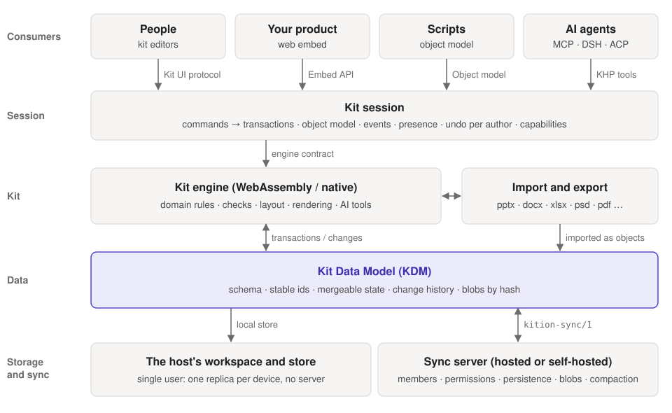

# Kition kit platform

These pages describe how **Kition** builds, hosts, and connects its kits: the
Kit Data Model, the engine contract, the Kit UI protocol, the Kit Process
Protocol, the sync protocol, the embed, the object model, collaboration,
extensions, file handles, pointer tools, links, and drawing objects. The
Kition SDK implements them.

**They are not the Kit Harness Protocol (KHP).** KHP covers only how an AI uses a kit: a kit is an MCP server that follows KHP's tool
conventions (the tools, their results and diagnostics, the error codes, the
draft and safety rules), with the tiers basic, Agent-ready, and Agent-ready
complete, a minimal manifest, and the conformance tests (`khp check`). The KHP specification is a separate distribution input. A KHP kit needs
none of the pages here: a basic kit needs no data model and no real preview,
and its drafts may work in file mode.

These contracts define how kits, hosts, embedding applications and SDK packages
exchange documents, commands and changes.

*Kition's implementation architecture, not a KHP requirement. Every consumer
goes through the same session; every kit shares the same data model.*

Start with [the data model introduction](data-model.md), which explains why
Kition's kits share one data model and what that gives collaboration and,
later, version control.

## 1. Kition and KHP

| | KHP | Kition kit platform (this folder) |
| --- | --- | --- |
| For | Anyone who makes a kit for AI agents, and any agent harness | Kition's kits, Kition's hosts, the Kition SDK |
| A kit is | An MCP server with the KHP tools | A WebAssembly engine on the Kit Data Model, its own editor, a package, and headless executables |
| Defines | Tools, results, diagnostics, errors, drafts and safety rules, the minimal manifest, tiers, `khp check` | Everything else on this page |
| Data model | None required; an object model is optional | The Kit Data Model (KDM), required for collaboration |
| Drafts | File mode is enough | Drafts are forks of the document's replica, merged as one transaction |

Kition's kits are KHP kits too: `kition-kits-mcp` serves their tools over MCP
([agent bindings](sets/agent.md) section 8.1), and Kition's release tiers
require the KHP tiers ([levels](kits/levels.md)).

To serve all kits from one mounted workspace over stdio MCP, see the
[container image definition and client configuration](https://github.com/KitionAI/kition-sdk/blob/main/tools/container/README.md).
Its build and runtime validation status is recorded there.

## 2. Roles

| Role | What it is |
| --- | --- |
| **Kit** | An engine (WebAssembly, run in a worker per document), its own editor, a manifest (`kit.json`), and headless executables for agents |
| **Host** | Shows kit editors, owns files and storage, enforces safety. `@kition/embed` makes any web page a host; Kition's desktop client is one too |
| **Agent harness** | Runs a model, its tools, and its loop: Claude Code, Codex, DeepSeek Harness, Kition's agent, or the integrator's own |
| **Person** | Edits in the host and works with the agent |

## 3. Capability sets

The platform is a core model plus **capability sets**. Each set is versioned
on its own, implemented by one SDK package, and tested on its own.

| Set | Read it to | SDK |
| --- | --- | --- |
| [`KitModel 1.1`](sets/model.md) | Understand what a kit's document is: typed objects, identity, transactions, exchange. Every other set builds on it | inside every kit |
| [`KitAgent 1.4`](sets/agent.md) | How Kition implements KHP: the Kit Process Protocol binding, the Kit AI bridge, the embed's agent port, DeepSeek Harness, the Agent Client Protocol, `kition-kits-mcp` | MCP server, headless executables |
| [`KitFiles 1.1`](sets/files.md) | Let a kit read, create, and replace files beyond its document, and print, through handles the host grants | `@kition/kit-host`, `@kition/kit-editor`, headless executables |
| [`KitLinks 1.0`](sets/links.md) | Let a document link other files: read linked files, show pictures of other kits' files, open files and web addresses in the host, list backlinks, and keep links working when files move | `@kition/kit-host`, `@kition/kit-editor`, headless executables |
| [`KitPointer 1.0`](sets/pointer.md) | Know what every kit's pointer tools do with a gesture, what the person selected, and which object a point in a preview shows | `@kition/kit-editor`, `@kition/kit-dev-host` |
| [`KitEmbed 1.8`](sets/embed.md) | Put a kit's editor in a web page with your storage and users | `@kition/embed` |
| [`KitObjectModel 1.0`](sets/object-model.md) | Read and edit a document from code, in a page or Node | `@kition/script` |
| [`KitCollab 1.3`](sets/collab.md) | Let people co-edit, comment, and sync across devices | `@kition/sync`, Kition Server |
| [`KitExtensions 1.0`](sets/extensions.md) | Add commands and panels to kit editors | `@kition/extensions` |
| [`KitText 1.0`](sets/text.md) | Index a document's words for search, also when they live outside the object model (PDF page text, text layers): `document.text`, the capability `document-text`, and the order a host reads words in | headless executables (`kition-headless`) |
| [`KitDrawing 1.0`](sets/drawing.md) *(draft)* | Insert and edit shapes and text boxes the same way in every kit that holds drawing objects, by pointer or by command | inside every kit with drawing objects |

The kits and the SDK are free in every form (embedded, single-user URL
embedding, scripts, headless on any machine, servers included, and MCP), in
development and in production, and need no licence key. Only collaboration
is paid: running Kition Server yourself (a `KITION1` licence, verified offline,
[licence-format.md](licence-format.md)) (free for companies of up to 8 people; Business and Enterprise
are paid) or co-editing on Kition Cloud (hosted, billed by usage).

### 3.1 Testing for a set

Hosts and servers advertise the sets they serve; scripts and kits test for a
set, never for a product version.

- **CS1** A host lists the sets it serves as `capabilitySets` in the Kit UI
  protocol's `ui/initialize` params (strings such as `"KitModel 1.0"`).
- **CS2** A sync server lists the sets it serves in the `capabilities` of its
  `sync/hello` result, next to its protocol capabilities.
- **CS3** Scripts test a set with `supports('KitCollab 1.3')` from
  `@kition/script` (against what its own implementation serves, or against a
  given list, such as a host's or a server's), never with a product or
  version check.

### 3.2 Versions and editions

- A set is versioned `Name major.minor`. A minor version only adds members,
  so a set `Name a.b` satisfies a request for `Name a.c` when `c` is at most
  `b`. A change that removes or changes a member bumps the major version.
- An **edition** of the platform is a dated snapshot of set versions,
  released with the SDK. Edition 2026.11: `KitModel 1.0`, `KitAgent 1.4`,
  `KitFiles 1.1`, `KitLinks 1.0`, `KitPointer 1.0`, `KitEmbed 1.5`,
  `KitObjectModel 1.0`, `KitCollab 1.3`, `KitExtensions 1.0`; the Kit UI
  protocol 2.1 (`kition-kit-ui/2`) and the Kit Process Protocol version 2. Its
  kits conform to KHP 1.0.
- A kit's manifest names the KHP version in `khp` (`1.0`) and the tier it
  claims in `level`; the platform's own versions are in its platform fields
  (`engine.contract` 2 for kits on the Kit Data Model, K10); see
  [kits/manifest.md](kits/manifest.md).

## 4. One example

A web application embeds Kition's Sheet and Slide kits
([getting the SDK](getting-the-sdk.md)). Those two kits are not published yet; the published Note
kit works the same way:

1. The page mounts two editors with `@kition/embed` and its own storage
   (`KitEmbed 1.5`): `Q3.xlsx`, and `Q3 review.pptx`, a slide its storage
   created from a template.
2. The page opens an agent port on each editor and relays both to the
   application's server, where its agent connects to them over MCP
   ([`KitAgent 1.4`](sets/agent.md) section 8.4). The agent reads the workbook
   with `sheet_query`, fills the slide with `slide_run` and `slide_batch` in a
   **draft**, and calls `slide_check`, which reports text overflowing on
   slide 4. It fixes that, checks again (no errors), and calls
   `slide_draft_ready`.
3. The person compares the draft with the slide in the page
   (`editor.draft.compare`) and merges it as one undo step; a colleague
   co-editing the slide on Kition Cloud, with a sync token the application's
   server obtained, sees the result at once (`KitCollab 1.3`).

## 5. Map of this folder

| Path | What |
| --- | --- |
| [`data-model.md`](data-model.md) | Introduction to the Kit Data Model: design, collaboration, and version control |
| [`layers.svg`](layers.svg) | The layered architecture diagram above |
| `sets/` | The capability sets, one page each |
| `reference/` | Full protocol references the sets point to: the Kit UI protocol, the Kit Process Protocol (headless), the sync protocol, the embed and object model APIs, extensions, the engine contract |
| `kits/` | How Kition builds kits and hosts: manifest, engine and host contracts, kit editors, kit conformance levels (L1 to L6, the convergence suite), implementations, [adopting call context](kits/call-context.md) |
| [`getting-the-sdk.md`](getting-the-sdk.md) | Getting the SDK bundle, and the kits in it |
| [`licence-format.md`](licence-format.md) | The `KITION1` licence of Kition One and Kition Server |
| [`conformance.md`](conformance.md) | Conformance per set; Kition's Agent-ready release checks |

### 5.1 Where each requirement lives

| IDs | Page |
| --- | --- |
| M, P | [sets/model.md](sets/model.md), performance rules P1 to P5 in [kits/engine.md](kits/engine.md#performance-rules) |
| A8, A17, A20, A23, D1–D4; Kition's form of A1–A44 | [sets/agent.md](sets/agent.md) (KHP 1.0 holds the protocol's A rules) |
| FA | [sets/files.md](sets/files.md) |
| HC-P, LR1, LR3–LR6, PV, OP, LK | [sets/links.md](sets/links.md) |
| PT | [sets/pointer.md](sets/pointer.md) |
| EM | [sets/embed.md](sets/embed.md) |
| OM | [sets/object-model.md](sets/object-model.md) |
| EX | [sets/extensions.md](sets/extensions.md) |
| DR | [sets/drawing.md](sets/drawing.md) |
| T | [sets/text.md](sets/text.md) |
| CS1–CS3 | this page; CS4 in [sets/collab.md](sets/collab.md) |
| K3, K6–K15, K18, K21, K22 (and Kition's form of K1–K17) | [kits/manifest.md](kits/manifest.md) |
| E | [kits/engine.md](kits/engine.md) |
| H, LR2 | [kits/host.md](kits/host.md) |
| U | [kits/ui.md](kits/ui.md) |
| L1–L6, the convergence suite | [kits/levels.md](kits/levels.md) |
| UI-K, UI-H, UI-S, UI-N and the other UI- rules | [reference/ui-protocol.md](reference/ui-protocol.md) |
